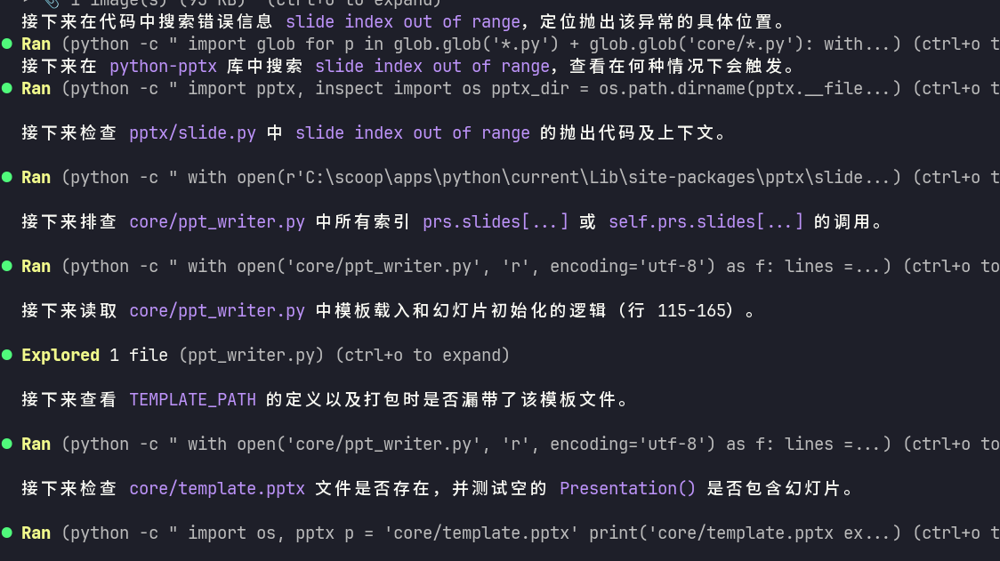

# agy-saymore

让 [Antigravity CLI（`agy`）](https://antigravity.google) 执行任务的时候告知用户自己在干嘛，而不是默默干活不汇报。

## 效果



## 安装

需要 Node.js 18 及以上（hook 用 `node hooks/checklist.js` 执行）。

一条命令安装：

```bash
agy plugin install https://github.com/VedaChen/agy-saymore/archive/refs/heads/main.zip
```

安装后 `agy plugin list` 应显示 `progress-checklist (enabled)`，新会话立即生效。

## 工作方式

| 事件 | 作用 |
| --- | --- |
| `PreToolUse` | 记录每次工具调用（名称、参数摘要、开始时间），不改变权限判定 |
| `PostToolUse` | 记录成功 / 失败与错误信息 |
| `PreInvocation` | 有新调用时注入一条「进度 + 检查表」；没有变化时不输出 |
| `rules/AGENTS.md` | 要求模型在每次工具调用前说明目的，并尽量逐条执行 |

进度通过 `systemMessage.renderInfo.markdown` 渲染给用户（CLI 1.5.15 实际支持的字段；
`metadata.user_markdown` 在 CLI 中会导致 hook 崩溃，不要使用）。
同时用 `systemMessage` 给模型一行极简进度，可用 `sendToModel` 关闭。

同一个模型回合里并行发出的多个工具调用之间，CLI 没有可插入 UI 的 hook 事件，
因此插件通过 `rules/AGENTS.md` 引导模型逐条说明、逐条执行。

## 配置

`hooks/config.json`：

| 字段 | 默认 | 说明 |
| --- | --- | --- |
| `sendToModel` | `true` | 是否把一行进度作为 systemMessage 发给模型 |
| `maxEntries` | `6` | 进度里最多列出最近几条调用 |
| `checklist` | 三项 | 默认检查项 |

## 项目自定义检查表

在工作区任意祖先目录放置以下任一文件即可覆盖默认检查项
（向上最多查找 12 层，遇到 `.git` 停止）：

`.agents/checklist.json`：

```json
{ "items": ["先读需求再改代码", "只改必要文件", "改完自检不编译"] }
```

或 `.agents/checklist.md`：

```markdown
- 先读需求再改代码
- 只改必要文件
- 改完自检不编译
```

## 状态与清理

状态按 `conversationId` 存放在 `PLUGIN_DATA`（未提供时为 `~/.agy-progress-checklist`），
写入采用临时文件 + rename 的原子替换；超过 7 天的状态文件会自动清理。

## 目录结构

```
agy-saymore/
├── plugin.json
├── hooks.json
├── hooks/
│   ├── checklist.js
│   └── config.json
├── rules/
│   └── AGENTS.md
├── assets/
│   └── demo.png
├── README.md
└── LICENSE
```

## 许可

MIT
